# Campaign Analytics

[](https://github.com/abdullahrather/streaming-ad-platform/actions/workflows/ci.yml)
[](./LICENSE)
[](https://github.com/abdullahrather/streaming-ad-platform/releases)

An ad platform for a streaming service. Companies upload video ads and plan campaigns as a team, the platform decides which ad plays in each ad break, a real player shows it, every view and click is measured, and a live dashboard shows how each campaign is performing.

Built with Node.js, TypeScript, Express, Prisma, PostgreSQL, Redis and FFmpeg, with a React dashboard. It has been load-tested at 10,000 events per second for five minutes with none lost or double-counted, including through a worker crash. See the [load test results](./docs/load-test.md). All brands, shows and traffic in the demo are fictional.


| Campaign detail | Interactive API docs |
|---|---|
|  |  |

| Demo streaming site | Ad review |
|---|---|
|  |  |

| Live forecast | A/B test results |
|---|---|
| 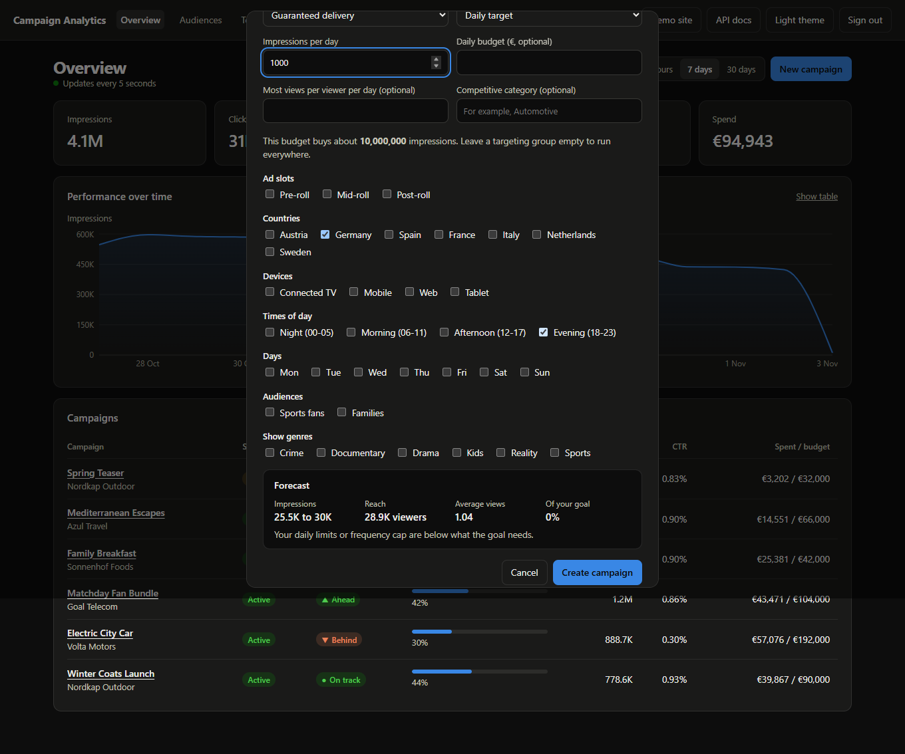 | 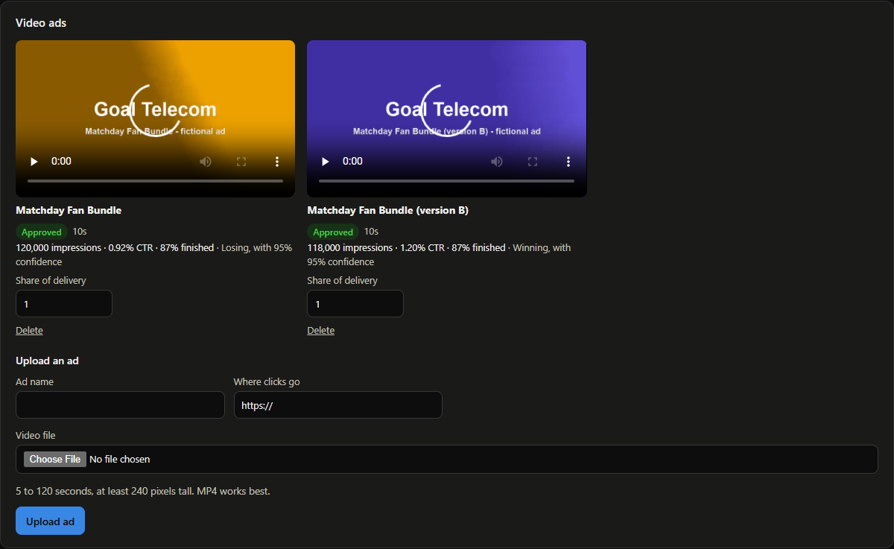 |

| Campaign comparison | Reports with CSV, PDF and email |
|---|---|
| 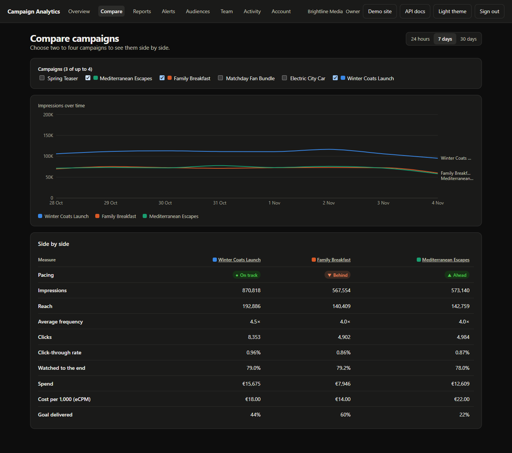 | 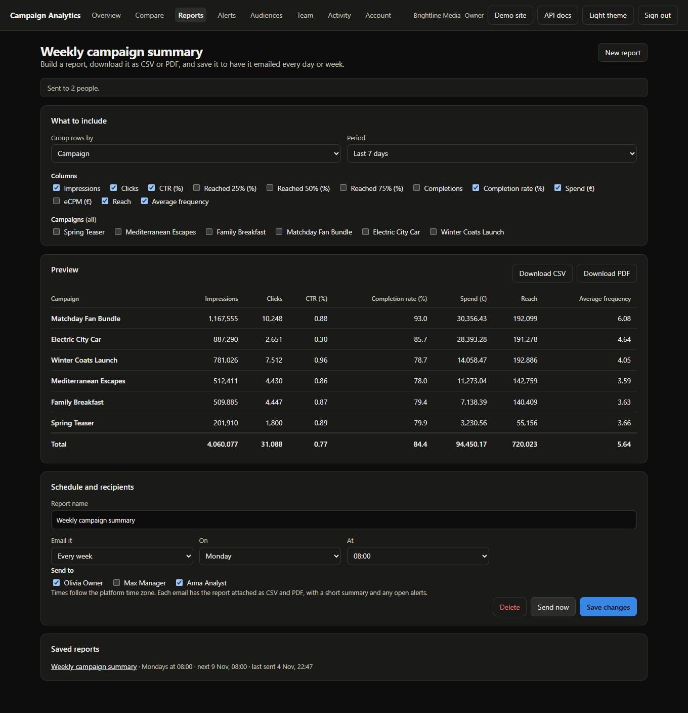 |

| AI assistant (optional) | Delivery check and approved changes |
|---|---|
| 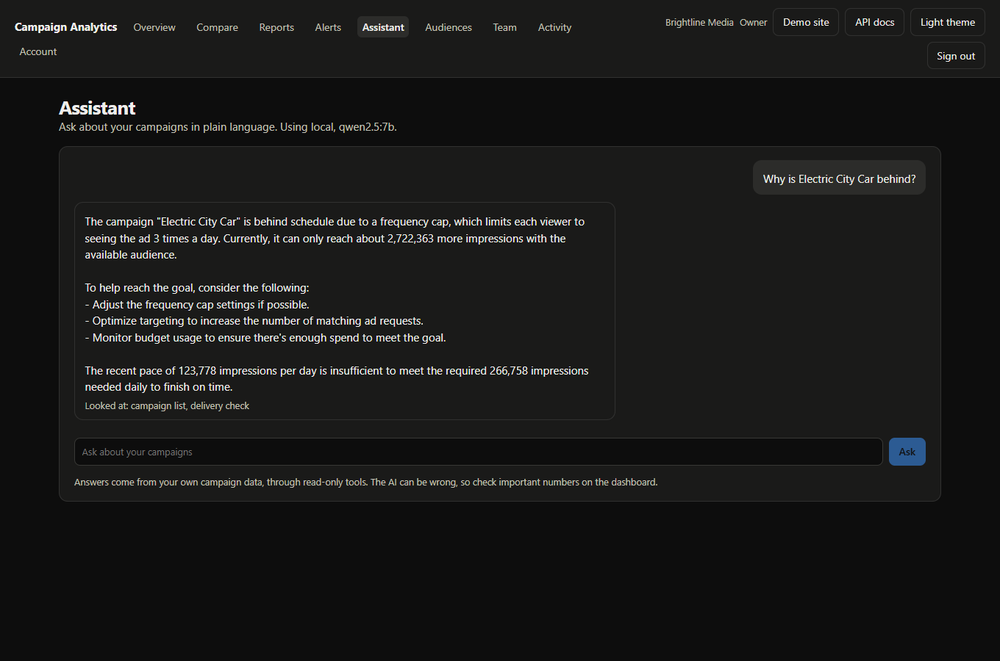 | 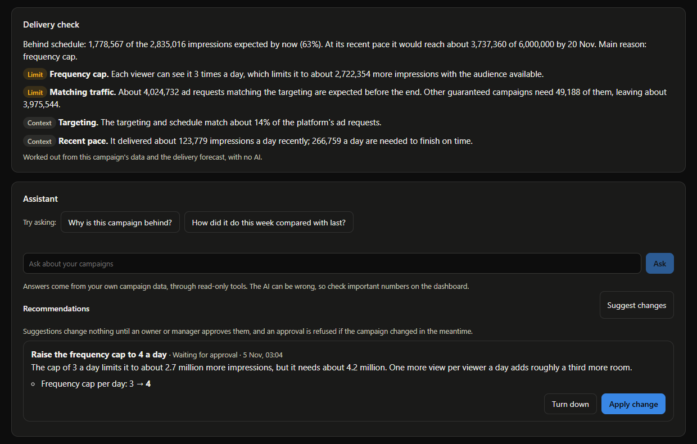 |

| AI settings for admins |
|---|
| 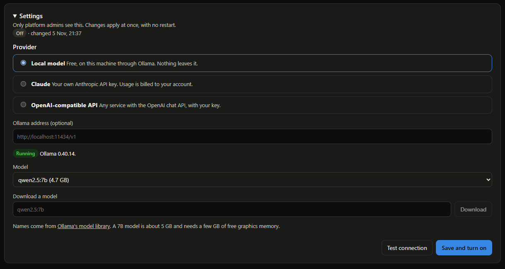 |

| Plans, card payments and billing details |
|---|
| 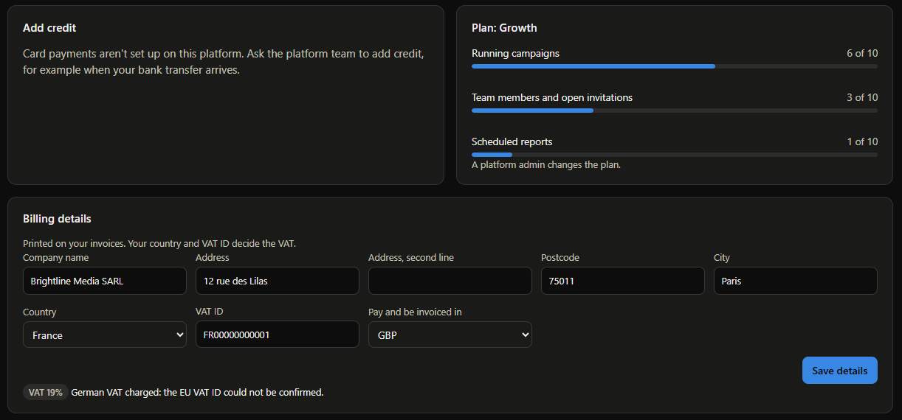 |

| Prepaid billing | Publisher revenue |
|---|---|
| 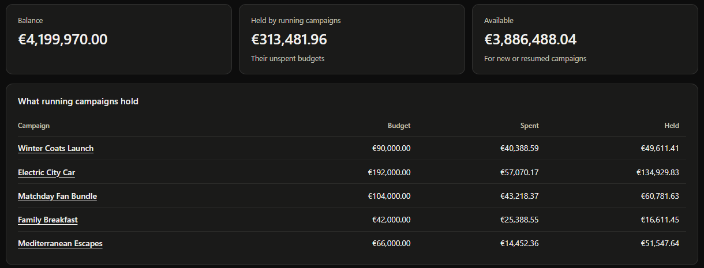 | 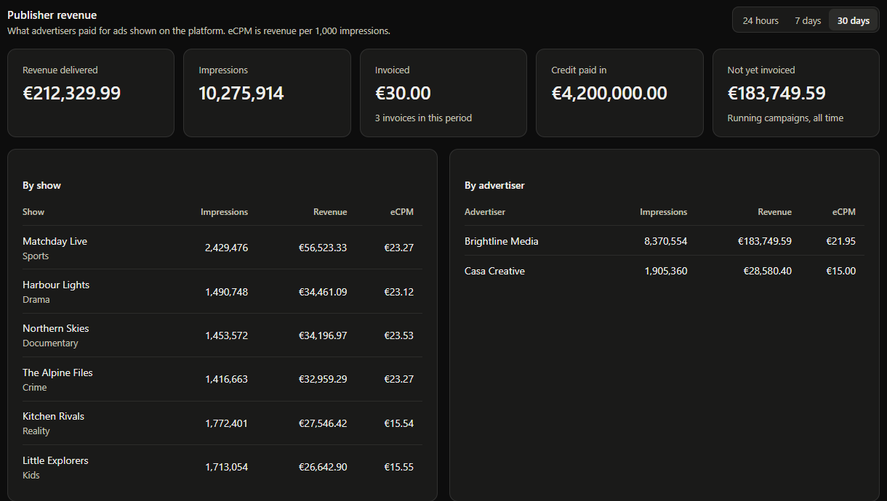 |

| Platform health in Grafana |
|---|
| 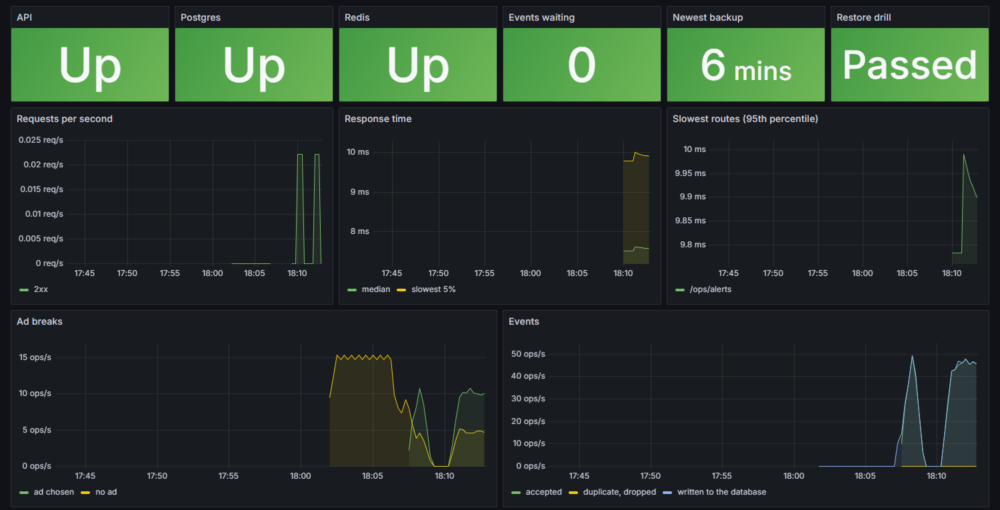 |

| Team management | Admin console |
|---|---|
|  |  |

## Run it

You need Node.js 22 or newer and [Docker Desktop](https://www.docker.com/products/docker-desktop/), which runs Redis. PostgreSQL and FFmpeg install with the project.

```bash
npm install
npm run dev
```

Open **http://localhost:5173** and choose a demo account. The demo streaming site is at **http://localhost:5173/watch**, and interactive API docs are at **http://localhost:3000/docs**. Press `Ctrl+C` to stop.

The first run creates a local PostgreSQL in `.data/`, sets up the tables, and adds 30 days of demo data, including short fictional videos made with FFmpeg. Your data stays between runs. To start fresh, stop the app, delete `.data/`, and run `docker compose down -v`.

Redis keeps running in Docker after you stop the app, so queued events are safe. To stop it, run `docker compose stop redis`.

| Account | Email | Password | Sees |
|---|---|---|---|
| Owner | `advertiser@example.com` | `advert1234` | Brightline Media: campaigns and team |
| Manager | `manager@example.com` | `manager1234` | Brightline Media: campaigns and activity |
| Analyst | `analyst@example.com` | `analyst1234` | Brightline Media: read-only |
| Other company | `rival@example.com` | `rival1234` | Casa Creative, kept apart from Brightline |
| Admin | `admin@example.com` | `admin1234` | Everything, plus the admin console |
| Guest | `guest@example.com` | `guest-demo` | Everything, read-only |

## What it does

Streaming services with an ad tier show short ads before, during and after episodes. Three parties meet here:

- **The advertiser** wants their ad seen by the right people for a set budget.
- **The platform** has to choose an ad for every ad break and keep each campaign on schedule.
- **The viewer** watches, and the player reports what happened.

This app is the part in the middle:

```
 Advertiser ──── dashboard ───▶ Campaigns: budget, dates, targeting
                                    │
 Player: "ad break in this show" ──▶ GET /ad-decision ── picks the best campaign
                                    │
 Player: "it played, was clicked" ─▶ POST /events ────── adds up hourly totals
                                    │
 Advertiser ◀─── live charts ────── Analytics
```

The app includes demo traffic that plays the part of the viewers, so the numbers move while you watch. Run with `SIMULATE=0` to turn it off.

**Things to try:** create a campaign targeting one country and watch it start delivering within seconds. Pause it and see the numbers stop. Compare Connected TV with Mobile on a campaign's page. Then open **Reports**, press **Send now** on the weekly summary, and find it in the local mailbox with its CSV and PDF attached.

### From upload to playback

1. **Upload.** A manager uploads a video to a campaign. Files that aren't real videos, last under 5 or over 120 seconds, or are too small are refused straight away.
2. **Convert.** FFmpeg turns the upload into web-friendly H.264 in the background, with a preview image.
3. **Review.** A platform admin watches it on the **Ad review** page and approves or rejects it. The uploader is told by email. Until then the video stays private.
4. **Play.** Open the demo site and press play. Ads run before, during and after the episode, and a side panel shows each event the player reports.
5. **Measure.** Impressions, the 25%, 50% and 75% marks, completions and clicks reach the campaign's page, including a chart of how far viewers watch.

Run with `SIMULATE=0` to turn off demo traffic, and the dashboard shows only what you played yourself.

### The terms on the dashboard

| Term | Meaning |
|---|---|
| **Impression** | One ad played once to one viewer. |
| **Click-through rate (CTR)** | The share of impressions that were clicked. TV is low because viewers rarely can. |
| **Ads watched to the end** | The share of ads that played to completion. Mid-roll is highest: viewers want the show back. |
| **CPM** | The price per 1,000 impressions. |
| **Creative** | The video ad itself. A campaign can have several, and one is picked at random. |
| **VAST** | The ad industry's standard XML format, which tells a video player what to play and where to report. |
| **Reach** | How many different viewers saw a campaign. |
| **Frequency** | How many times the average viewer saw it. |
| **Second-price auction** | The highest bid wins, but pays only just above the next bid. |
| **Quartile** | The 25%, 50% and 75% points of an ad, used to see where viewers stop watching. |
| **Ad slot** | Pre-roll (before the episode), mid-roll (during) or post-roll (after). |
| **Flight** | The dates a campaign runs. |
| **Impression goal** | The number of impressions the advertiser bought. |
| **Pacing** | Delivery so far compared with an even schedule. Behind means the campaign may miss its goal. |

### Campaign controls

| Control | What it does |
|---|---|
| **Forecast** | Shows expected impressions and reach as you build a campaign, then tracks delivery against it |
| **Frequency cap** | Limits how many times one viewer sees a campaign in a day |
| **Schedule** | Runs ads at chosen times of day and on chosen days |
| **Pacing** | Spreads delivery evenly, spends as fast as possible, or aims for a daily target |
| **Daily budget** | Stops spending for the day at a set amount |
| **Audiences** | Targets people by what they watch, only if they consented |
| **Competitive separation** | Keeps brands in the same category out of the same ad break, and never plays one campaign twice in a break |
| **A/B tests** | Splits delivery between ads and only names a winner at 95% confidence |
| **Auctions** | Bids for traffic guaranteed campaigns don't need, paying just above the next bid. Bids under `AUCTION_FLOOR_CPM_CENTS` don't compete |

These limits are checked in the same atomic step that reserves the ad, so they hold under concurrent traffic. See [how forecasts work](./docs/forecasting.md).

### Reports and alerts

| Feature | What it does |
|---|---|
| **Reach and frequency** | Counts different viewers for any period, and how often the average viewer saw the ad |
| **Period comparison** | Every headline number shows its change against the previous period of the same length |
| **Campaign comparison** | Puts two to four campaigns side by side, on one chart and one table |
| **Drop-off** | Shows where viewers stop watching, by ad slot, device or show |
| **Report builder** | Groups by day, campaign, slot, country, device or show, with chosen columns, and downloads as CSV or PDF |
| **Scheduled reports** | Emails a saved report every day or week, with a summary, open alerts and both files attached |
| **Alerts** | Watches for delivery falling behind, budget running out early and sudden drops, and emails once when one starts |

The demo opens real alerts on its own data within seconds of starting: two campaigns are behind schedule. See [how reporting and alerts work](./docs/reporting.md), including why PostgreSQL is still enough.

### Delivery check and AI assistant

Every campaign page has a **delivery check** that says whether the campaign will reach its goal and what holds it back: being paused, having no approved ad, too little matching traffic, the budget, a daily limit or the frequency cap. It's worked out from the campaign's data and the forecast, with no AI.

The **AI assistant** is optional and off by default. A platform admin turns it on from the **Assistant** page with Claude (their own API key), any OpenAI-compatible API, or a free local model through [Ollama](https://ollama.com) with no key and no data leaving the machine. The page tests the connection, finds Ollama and downloads models through it, and applies changes with no restart. Keys are stored encrypted and never sent back to the browser. `AI_PROVIDER` in `.env` also works and takes priority.

| Feature | What it does |
|---|---|
| **Questions** | Answers questions like "why is this campaign behind?" in plain language, using read-only tools that see only what the person asking can see |
| **Suggested changes** | Proposes setting changes with the numbers behind them. Nothing changes until an owner or manager approves, and an approval is refused if the campaign changed since |
| **Draft from a brief** | Turns a written brief into a filled-in campaign form to check and save, listing every value it assumed |
| **Alert explanations** | Adds a short "why" to new alerts and their emails |
| **Weekly summaries** | Adds "what changed and why" to scheduled report emails |
| **Ad checks** | Gives reviewers a first look at each new ad's poster frame. Advice only: a person still approves every ad |

See [how the AI assistant works](./docs/ai.md), including what it can see, how changes are approved, and how it was tested.

Viewing profiles exist only for viewers who consented. They expire after 90 days, and a viewer can delete theirs at any time.

### Billing

Campaigns are paid from a prepaid balance, so the platform never delivers ads nobody has paid for.

| Feature | What it does |
|---|---|
| **Prepaid balance** | Each organisation's money, kept as a ledger of credits and charges that is never edited |
| **Holds** | A running campaign holds its unspent budget. Starting, resuming or raising a budget needs that much to be available |
| **Invoices** | Each campaign is invoiced once, for what it really cost, about an hour after it ends. Numbered with no gaps, paid from the balance, and emailed as a PDF |
| **Publisher revenue** | What the platform earned from the ads it showed, by show, advertiser and ad slot, with eCPM |
| **EU VAT** | 19% for German customers, the reverse charge for EU businesses whose VAT ID the EU's VIES service confirms, and none outside the EU |
| **Currencies** | Each organisation pays and is invoiced in its own currency, at the European Central Bank's daily rate, while prices and the balance stay in euros |
| **Card payments** | Optional, through Stripe Checkout with the runner's own account. Credited once, by webhook or when the payer comes back |
| **Plans** | Starter, Growth and Enterprise limit running campaigns, team members and scheduled reports |

Platform admins add credit, for example when a bank transfer arrives, and set plans. Ad decisions never check the balance: budgets are already hard limits, and the balance covers every running budget. See [how billing works](./docs/billing.md).

### Accounts and teams

Each company is an organisation with its own private campaigns and team. A person can belong to several and switch between them.

| Role | Can do |
|---|---|
| **Owner** | Everything below, plus invite people, change roles and remove members |
| **Manager** | Create and change campaigns, save and schedule reports, and see team activity |
| **Analyst** | View campaigns, and run and download reports |

The platform also has a **sign-up flow** with email confirmation, **password reset**, **two-factor login** with an authenticator app and recovery codes, a list of **signed-in devices**, an **activity log** of who changed what, and an **admin console** for suspending people or organisations.

Emails appear in the **local mailbox** at `/#/mailbox`, so all of this works with no mail server. To send real email, set `SMTP_URL` in `.env`.

The dashboard is in **English and German**. It follows the browser's language until someone picks one from the header or the sign-in page, and numbers, money and dates follow it too.

### Privacy

Viewers' interest profiles exist only with their consent, and withdrawing it deletes the profile. Viewers can download or delete everything held about them, and so can dashboard users from the **Account** page, where they can also delete their account. Old sign-ins, links, invitations and IP addresses are deleted on a schedule. See [privacy and GDPR](./docs/privacy.md).

### How an ad gets chosen

For each ad break, the platform keeps campaigns that are active, inside their dates and schedule, under their limits, and matching the country, device, slot, show genre and audience.

Guaranteed campaigns behind schedule go first, furthest behind first. Auction campaigns then compete for the rest. Guaranteed campaigns ahead of schedule come last, and even-paced ones wait. A campaign is marked completed when it reaches its goal or budget, or passes its end date.

Real players use `/vast`, which only considers campaigns with an approved ad. `/ad-decision` also includes campaigns without one, which lets ad servers and demo traffic run on numbers alone.

## How it stays secure

- **Passwords** are hashed with bcrypt. Sign-in, sign-up and password reset respond the same way whether or not an account exists.
- **Sessions** use a 15-minute access token held in memory, and a rotating refresh token in an httpOnly cookie. Reusing an old refresh token ends the session.
- **Two-factor sign-in** locks for 15 minutes after five wrong codes, counted per account, and emails the owner.
- **Uploads** are treated as untrusted: FFmpeg is limited to local files and runs without a shell, and the original is deleted after conversion.
- **Players use 15-minute tokens.** A publisher's server exchanges its secret key for one with `POST /player-tokens`, so the key never reaches a device.
- **Invalid traffic is filtered.** Bots, viewers requesting too many ads, and ads finished impossibly fast are removed from results and reported on the campaign's page.
- **Player events** use signed links from the VAST response, so players hold no secret and can't report on another campaign.
- **Permissions** are checked against the database on every request, so sign-outs, suspensions and role changes apply immediately.
- **Secrets** are never stored in plain text: email links and recovery codes are hashed, and two-factor secrets are encrypted.
- **Scanned in CI:** CodeQL checks the code, pull requests that add a vulnerable package fail, and `npm audit` checks both packages. GitHub's secret scanning blocks pushed keys.

## Using it with other video players

`/vast` returns standard VAST 4.2 and allows requests from any website, so any VAST-compatible player can show these ads. It needs a player token. `web/src/player/ad-sdk.ts` is a small player SDK with no dependencies:

```ts
const ad = await requestAd({ serverUrl: '/vast', token, showId, slot: 'PRE_ROLL', country: 'DE', device: 'CTV' });
if (ad) await playAd(videoElement, ad, { onEvent: console.log });
```

## How events are counted

Events go through a queue, so the API stays fast and a failure can't lose or repeat them:

```
 Player or ad server
       │  each event has a unique ID
       ▼
 API ──▶ Redis script: drop IDs already seen, queue the rest (one atomic step)
                                │
                                ▼
 Worker ──▶ PostgreSQL transaction: save the totals and the queue entry's ID together
                                │
                                ▼
                     Remove the entry from the queue
```

- **A retry can't count twice.** Repeated event IDs are dropped, so sending a batch again is always safe. Events older than the one-hour duplicate window are refused.
- **A crash can't lose events.** An entry stays on the queue until its totals are saved. If a worker dies, another picks up its work.
- **A crash can't count twice.** The queue entry's ID is saved in the same transaction as the totals, so an entry redelivered after a crash changes nothing.

## Running it in production

`npm run stack` starts the platform with its monitoring and backups in Docker: Grafana, Prometheus, Alertmanager, Loki for logs, Tempo for traces, and a backup service.

- **Logs** are structured JSON with a request ID on every line, linked to their traces.
- **Metrics** at `/metrics` cover request times by route, ad decisions, events and the queue, whether Postgres and Redis answer, and backups.
- **Traces** follow each request through Express and Redis.
- **Alerts** email the platform admins when something breaks, such as a database not answering, failing requests, ad breaks getting no ads, a stalled event worker, or a backup that's too old or won't restore. With Redis stopped, the alert email arrived in 97 seconds.
- **Backups** are taken daily and restored into a scratch database to prove they work, checking every table's row count. CI runs the same restore drill on every pull request.

See [the operations guide](./docs/operations.md).

## How it stays fast

- **Decisions use no database.** Running campaigns are kept in memory and live delivery counts in Redis.
- **Limits are reserved, not checked afterwards.** Each ad is claimed in one atomic step, so a campaign can't pass its goal or budget, however many requests race.
- **Hourly rollups.** Events are added into one row per campaign, hour, show, slot, country and device, not stored one by one. The table grows with variety, not with traffic.
- **Batched writes.** The worker turns thousands of events into a few upserts.
- **One query per view.** Analytics run as a single SQL statement, so more campaigns never means more database round trips.
- **Reach in 12 KB.** Unique viewers are counted in HyperLogLog sketches, one per campaign per day, instead of storing every viewer.
- **Reports stay under a second.** A 90-day report over 9.9 million rollup rows takes about half a second. See [the measurements](./docs/reporting.md#why-postgresql-is-enough-for-now).

## API

Interactive docs are at `/docs`, and the raw OpenAPI document is at `/openapi.json`. They are generated from the validation schemas, and a test fails if a route is undocumented.

Dashboard routes need `Authorization: Bearer <token>` from login. Ad server routes need an `x-ingest-key` header.

| Method | Route | Purpose |
|---|---|---|
| `GET` | `/live` | Service status, without using the database |
| `GET` | `/health` | Service and database status |
| `GET` | `/auth/options` | Which sign-in options apply here |
| `POST` | `/auth/register` | Create an account and organisation |
| `POST` | `/auth/login` | Sign in; limited to 20 attempts per 15 minutes |
| `POST` | `/auth/two-factor` | Finish signing in with a code |
| `POST` | `/auth/refresh` | Replace an expired access token |
| `POST` | `/auth/forgot-password` | Send a reset link |
| `GET` | `/auth/me` | Your profile and organisations |
| `GET` | `/creatives` | List a campaign's video ads |
| `POST` | `/creatives` | Upload a video ad |
| `PATCH` | `/creatives/:id` | Change an ad's share of delivery |
| `POST` | `/player-tokens` | Exchange the ad server key for a player token |
| `GET` | `/vast` | Get an ad as VAST XML, for video players |
| `GET` | `/track/{event}` | Report ad progress, with a signed link from the VAST |
| `GET` | `/click` | Record a click and redirect |
| `GET` | `/player/catalogue` | Shows the demo site can play |
| `DELETE` | `/player/profile` | Delete a viewer's viewing profile |
| | `/account/*` | Password, devices and two-factor settings |
| | `/team/*` | Members, invitations and activity |
| | `/admin/*` | The admin console |
| `GET` | `/campaigns` | List campaigns, with `status`, `page` and `limit` |
| `POST` | `/campaigns` | Create a campaign |
| `GET` | `/campaigns/:id` | Read a campaign |
| `PATCH` | `/campaigns/:id` | Change a campaign, including pausing and resuming |
| `DELETE` | `/campaigns/:id` | Delete a campaign and its metrics |
| `GET` | `/campaigns/analytics` | Totals, pacing and spend per campaign, with `from` and `to` |
| `GET` | `/campaigns/analytics/timeseries` | Performance over time across campaigns |
| `GET` | `/campaigns/analytics/summary` | Totals for a period and the period before it |
| `GET` | `/campaigns/compare` | Two to four campaigns side by side, with `ids` |
| `GET` | `/campaigns/:id/analytics` | One campaign with its trend, breakdowns, reach and frequency |
| `GET` | `/campaigns/:id/diagnosis` | Why a campaign is behind and whether it will reach its goal, with no AI |
| `POST` | `/campaigns/forecast` | Predict delivery and reach before launching |
| `GET` | `/segments` | List audience segments |
| `POST` | `/segments` | Create an audience segment |
| `POST` | `/reports/run` | Run a report without saving it |
| `POST` | `/reports/export` | Download a report as CSV or PDF, with `format` |
| | `/reports/*` | Save, schedule, download and send saved reports |
| `GET` | `/alerts` | Campaign alerts, with `status=open` or `all` |
| `GET` | `/ai/status` | Whether the AI assistant is on, and which model it uses |
| `POST` | `/ai/ask` | Ask a question about your campaigns |
| | `/ai/campaigns/:id/recommendations` | List or ask for suggested changes |
| `POST` | `/ai/recommendations/:id/approve` | Apply a suggested change; also `/reject` |
| `POST` | `/ai/draft-campaign` | Draft a campaign from a written brief |
| | `/ai/settings`, `/ai/local/*` | Admin settings: provider, key, connection test, Ollama models and downloads |
| `GET` | `/billing` | Your balance, what running campaigns hold, history and invoices |
| `GET` | `/billing/invoices/:id/pdf` | Download an invoice |
| `PUT` | `/billing/details` | Billing details: address, country, VAT ID and currency |
| | `/billing/checkout`, `/billing/stripe/webhook` | Card payments through Stripe |
| | `/billing/organisations`, `/billing/revenue` | Admin: every balance, adding credit, plans, and publisher revenue |
| `GET` | `/shows` | The show catalogue |
| `GET` | `/ad-decision` | Choose an ad: `showId`, `slot`, `country`, `device` |
| `POST` | `/events` | Queue a batch of ad events, each with an `eventId` and `occurredAt` |

## Project layout

```
prisma/          Database schema, migrations and demo data
scripts/         Local database and dev startup
src/lib/         Storage, video conversion, email, security
src/modules/     account, admin, ai, alerts, audit, auth, billing, campaigns, creatives, delivery, demo, dev,
                 docs, playback, reports, segments, shows, team
src/middleware/  Sign-in and permission guards, API key guard, error handling
tests/           Integration tests against a real PostgreSQL
web/             The React dashboard, the demo streaming site and the player SDK
```

## Scripts

| Script | Purpose |
|---|---|
| `npm run dev` | Start everything |
| `npm test` | Run the integration tests |
| `npm run test:e2e` | Run the browser tests against the running app (see [CONTRIBUTING.md](./CONTRIBUTING.md)) |
| `npm run test:coverage` | Tests with a coverage report |
| `npm run lint` | Lint the API |
| `npm run format` | Format the code |
| `npm run typecheck` | Check TypeScript types |
| `npm run build` | Compile the API |
| `npm run load:test` | Run the load test and check the totals |
| `npm run forecast:check` | Test forecast accuracy against held-out history |
| `npm run db:seed` | Replace all data with fresh demo data |
| `npm run db:studio` | Browse the database in Prisma Studio |
| `npm run db:backup` | Back up the database |
| `npm run db:restore-drill` | Back up, restore into a scratch database, and check every table |
| `npm run db:restore` | Restore a backup, into another database or over the live one |
| `npm run stack` | Run everything in Docker with monitoring and backups |

## Docker

With Docker installed, this runs the database and the app at **http://localhost:3000**:

```bash
docker compose up --build
```

To add monitoring and backups (Grafana at **http://localhost:3001**), run `npm run stack`. See [the operations guide](./docs/operations.md).

For a real deployment, build the `production` image target and set `DATABASE_URL`, `JWT_SECRET` and `INGEST_API_KEY`. The app refuses to start in production with the placeholder secrets.

## Public demo

`render.yaml` deploys a read-only demo: the app and Redis on Render's free plans, and its database on Neon's free plan. This setup hasn't been tested with Redis. Demo mode leaves only the guest account with a known password, runs traffic only while someone is viewing, and refreshes its data when it's more than a week old. The first visit after a quiet period takes about a minute while the app wakes up.

## Known limits

This is a working demonstration, not a system that has run under real load.

- Videos are stored on local disk and streamed by the app, with no CDN or adaptive quality. The storage layer is ready for cloud storage.
- The demo player takes its country and device from a menu, where a real service would detect them.
- Forecasts are tested against generated history, and the reach estimate hasn't been checked against real viewers. See [how forecasts work](./docs/forecasting.md).
- Schedules and daily limits use one platform time zone, set by `PLATFORM_TIMEZONE`.
- A reserved ad that never plays is only returned after its campaign has been quiet for two minutes, so a campaign near its limit can briefly under-deliver.
- Dashboard totals lag slightly behind live traffic, because events pass through the queue first.
- `/ad-decision` and `/events` share one API key, which suits a trusted ad server.
- In German, text written by the server stays in English: error messages, alert messages, delivery check findings and AI answers. The demo streaming site is English only.
- Deleted data stays in older backups until they're pruned. See [privacy limits](./docs/privacy.md#limits).
- Sign-ups, invitations, reports and alerts need `SMTP_URL` for real email; without it, messages stay in the local mailbox.
- Database queries aren't traced one by one, and the ApiDown alert can't be emailed through the API that's down. See [the operations guide](./docs/operations.md).
- Reach is an estimate, usually within 1 to 2%, and alert thresholds are the same for every campaign. See [how reporting and alerts work](./docs/reporting.md#limits).
- Card payments need the runner's own Stripe account; the webhook was only tested against a local stand-in. The VAT rules cover a seller in Germany selling to businesses. See [the billing limits](./docs/billing.md#limits).
- The AI assistant was tested end to end with a small local model, which answers "why is this campaign behind?" correctly but makes poor suggestions and drafts. Claude was tested only against a stand-in server, not the live API. See [the AI assistant's limits](./docs/ai.md#limits).

## Contributing

See [CONTRIBUTING.md](./CONTRIBUTING.md). Released under the [MIT License](./LICENSE).
