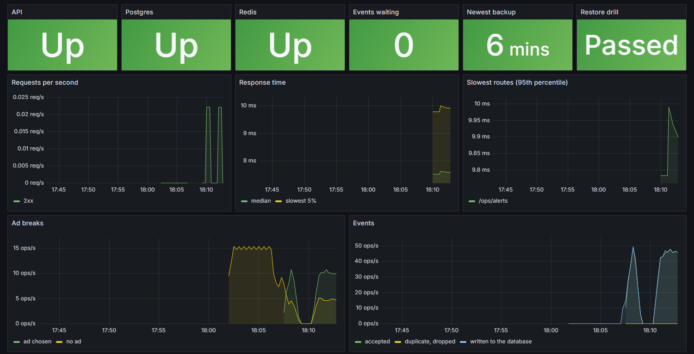

# Operations

How to see what the platform is doing, get told when something breaks, and get the data back if it's lost.

## The stack in one command

```bash
npm run stack
```

This runs `docker compose -f docker-compose.yml -f docker-compose.monitoring.yml up --build`, and starts the platform with everything needed to run it:

| Service | What it does | Where |
|---|---|---|
| API and dashboard | The platform, with demo traffic | http://localhost:3000 |
| Grafana | Dashboards, logs and traces | http://localhost:3001 (admin / admin, or `GRAFANA_PASSWORD`) |
| Prometheus | Collects metrics every 15 s and checks the alert rules | http://localhost:9090 |
| Alertmanager | Groups alerts and sends them on | http://localhost:9093 |
| Loki | Stores the logs | Inside the stack |
| Tempo | Stores the traces | Inside the stack |
| Backup | Backs up the database and proves it restores, now and every day | Inside the stack |

`docker compose up` on its own still runs just the platform, as before.

The tokens in `docker-compose.monitoring.yml`, `docker/prometheus/prometheus.yml` and `docker/alertmanager/alertmanager.yml` are for this local stack. A real deployment sets its own in those places.



## Logs

Logs are structured: one JSON object per line, with the level, the time, a message and the fields worth searching on, such as `campaignId` or `task`.

- **Request IDs.** Every request gets one, from the caller's `X-Request-ID` header if it sent a sensible one. It's sent back in the response and written on every log line for that request.
- **Trace links.** A line written while a request is traced carries its `trace_id`, so in Grafana a log line opens its trace, and a trace opens its log lines.
- **Where they go:**
  - In development they're printed readably to the terminal.
  - In production they go to standard output as JSON.
  - With `LOKI_URL` set, they're also sent to Loki.
- **Detail:** `LOG_LEVEL` sets how much is logged (`info` by default). Health checks and metrics scrapes aren't logged.

## Metrics

`GET /metrics` serves Prometheus metrics. With `METRICS_TOKEN` set, Prometheus sends it as a bearer token. Without one, the endpoint is only served outside production.

| Metric | What it tells you |
|---|---|
| `http_request_duration_seconds` | How long requests take, by method, route pattern (such as `/campaigns/:id`) and status |
| `ad_decisions_total` | Ad breaks asked for an ad, by whether one was chosen |
| `events_ingested_total` | Events received, accepted or dropped as duplicates |
| `events_written_total` | Events the worker added to the database |
| `event_queue_pending` | Event batches waiting to reach the database |
| `event_worker_last_batch_timestamp_seconds` | When the worker last wrote a batch |
| `dependency_up` | Whether Postgres and Redis answered, checked at each scrape |
| `invoices_issued_total` | Invoices issued |
| `scheduler_task_failures_total`, `scheduler_task_last_success_timestamp_seconds` | Scheduled reports, alert checks, billing and exchange rates |
| `backup_last_success_timestamp_seconds`, `backup_restore_drill_ok` | The newest backup, and whether its restore drill passed |

Node's own metrics (memory, CPU, event loop lag) are included too.

## Traces

With `OTEL_EXPORTER_OTLP_ENDPOINT` set (the standard OpenTelemetry setting, `http://tempo:4318` in the stack), each request is traced: the HTTP request, its Express route, and its Redis calls. Traces go to Tempo, and Grafana shows them. `OTEL_SERVICE_NAME` names the service (`campaign-analytics-api` by default). Health checks and metrics scrapes aren't traced.

Database queries aren't traced one by one. Prisma's tracing package for this Prisma version depends on an OpenTelemetry release with a known vulnerability, so it's left out. A request's trace still shows how long it took in total.

## Alerts

Prometheus checks these rules every 15 seconds (`docker/prometheus/alerts.yml`). Alertmanager sends firing and resolved alerts to `POST /ops/alerts`, which emails them to the platform admins. Without `SMTP_URL`, they arrive in the local mailbox.

| Alert | When |
|---|---|
| ApiDown | Prometheus can't reach the API for a minute |
| DependencyDown | Postgres or Redis doesn't answer for a minute |
| HighErrorRate | Over 5% of requests fail for 5 minutes |
| SlowRequests | The slowest 5% of requests take over a second, for 10 minutes |
| AdBreaksGetNoAds | Players ask for ads but none are chosen for 10 minutes |
| EventBacklogGrowing | Over 1,000 batches waiting for 5 minutes |
| EventWorkerStalled | Events waiting and none written for over 5 minutes |
| ScheduledTaskFailing | A scheduled task failed in the last 15 minutes |
| BackupTooOld | No backup in over 26 hours |
| RestoreDrillFailed | The last restore drill didn't match |

**ApiDown can't be emailed through the API,** since the API is what's down. It shows in Alertmanager and Grafana. To get it by email too, add an email receiver with your SMTP server to `docker/alertmanager/alertmanager.yml`.

**Tested in the stack:** with Redis stopped, the "redis is not answering" email arrived 97 seconds later. The "resolved" email arrived 106 seconds after Redis was back. The queued events caught up with nothing lost.

## Backups and restores

| Command | What it does |
|---|---|
| `npm run db:backup` | Backs up the database to `BACKUP_DIR` (`.data/backups`) and keeps the newest `BACKUP_KEEP` (14) |
| `npm run db:restore-drill` | Backs up, restores into a scratch database, and checks every table has exactly the rows the backup recorded |
| `npm run db:restore -- latest --into <name>` | Restores the newest backup into another database |
| `npm run db:restore -- latest --yes` | Replaces the live database with the newest backup |

- **Counts match the backup exactly.** A backup is a `pg_dump` custom-format file. The row counts are taken in the same database snapshot as the dump, so they match even while traffic keeps writing.
- **`latest.json`** records the backup, its counts and the last drill. The metrics read it, so the age of the newest backup and the drill result show in Grafana and can raise alerts.
- **Tool versions:** `pg_dump` and `pg_restore` must match the server's major version, because a newer `pg_dump` writes settings an older server can't restore. The restore drill found exactly this during testing. The scripts use a matching version from `PATH` if there is one, otherwise they run from Docker's official `postgres` image for the server's version. In the stack, the backup container has the client that matches its PostgreSQL 16.
- **Replacing the live database** loses everything written since the backup, so it needs `--yes`.

**Tested:**

- **On the local development database:** 27 tables and 358,622 rows, restored in 2 seconds.
- **In the Docker stack:** 27 tables and 349,310 rows, restored in under a second.
- **CI** runs the restore drill on every pull request.
- **A deliberately damaged restore,** with one row deleted after restoring, made the drill fail with the table and the counts.

## Settings

| Setting | Default | Meaning |
|---|---|---|
| `LOG_LEVEL` | `info` | `fatal`, `error`, `warn`, `info`, `debug`, `trace` or `silent` |
| `LOKI_URL` | | Also send logs to Loki |
| `METRICS_TOKEN` | | Bearer token for `/metrics` |
| `ALERT_WEBHOOK_TOKEN` | | Bearer token for `/ops/alerts`; without it, alerts are refused |
| `BACKUP_DIR` | `.data/backups` | Where backups and `latest.json` are |
| `BACKUP_KEEP` | `14` | How many backups to keep |
| `OTEL_EXPORTER_OTLP_ENDPOINT` | | Where to send traces; off when empty |
| `OTEL_SERVICE_NAME` | `campaign-analytics-api` | The service name on traces |
